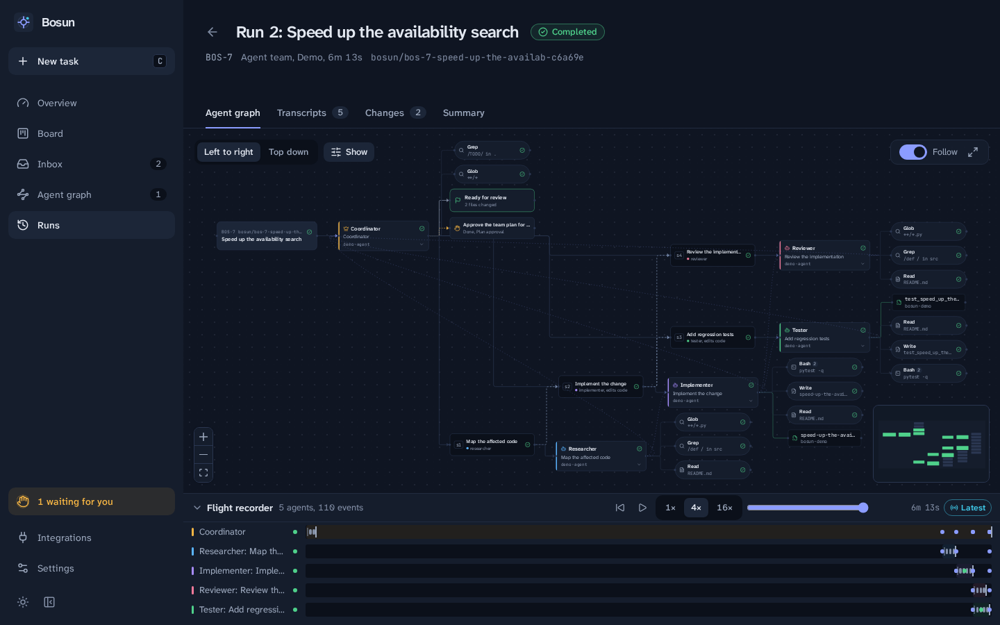

# Bosun

A local-first control room for running Claude Code agents against your own
repositories. It collects work from TODO comments, markdown checklists and
GitHub issues and pull requests into a Kanban board. It runs single agents or
coordinated agent teams through the Claude Agent SDK, each in its own git
worktree, and draws what they do as a live, replayable graph while they work.

Everything runs on your machine. Nothing is pushed, no pull request is opened,
nothing is deployed and nothing is written to GitHub. Agents ask before doing
anything outside a small allow-list, and those requests arrive in the UI as
approvals.

- **Board**: Backlog, Ready, In progress, Review, Blocked, Done. Agents can
  move a task as far as Review; only you mark it Done.
- **Inbox**: discovered TODOs, checklist items and GitHub issues and PRs
  wait here until you import or dismiss them.
- **Runs**: launch a single agent, a coordinator-led team, or let the
  coordinator choose. Watch the agent graph, read transcripts, approve tool
  use, send follow-ups, pause, resume and retry, review the diff, then merge
  into your branch or discard.
- **Agent graph**: built only from events Bosun recorded. You can
  zoom, focus, collapse, filter and replay a run with the flight recorder.



## Requirements

- Linux or macOS (Windows through WSL2)
- A Claude subscription, or an Anthropic API key, or Google Vertex AI
- To run directly on your machine (as a service or from source):
  - Python 3.11+ and [uv](https://docs.astral.sh/uv/), Node.js 20+ and npm,
    git
  - Optional: the GitHub CLI (`gh`) for GitHub import
  - Optional: `bubblewrap` and `socat` (Linux) for OS-level shell sandboxing
  - For the service: systemd (on WSL, with systemd enabled)
- To self-host in a container: Docker with Compose 2.24 or later. Nothing else.

The Claude Code CLI ships inside the `claude-agent-sdk` Python package (and the
Docker image), so a separate install is only needed to sign in (see below).

Run Bosun directly when it should reach projects anywhere on your machine and
use your own logins and toolchains. Run it in Docker to keep agents inside a
container that sees only the folders you mount.

## Run as a service (Linux)

```bash
git clone https://github.com/ArrushC/bosun.git
cd bosun
scripts/start.sh    # installs and starts a systemd user service on 127.0.0.1:8787
claude auth login   # only if Claude Code isn't signed in yet
gh auth login       # optional, for GitHub import
```

Open <http://127.0.0.1:8787>. The first run installs the service and builds the
web UI. Later runs start it if it isn't running, and leave it alone if it is.
Bosun runs as you:

- **Projects anywhere**: a workspace can be any folder you can write to.
  Agents still work in their own git worktree, inside the boundary described
  under Safety model.
- **Your logins**: Bosun uses your Claude Code login and your GitHub CLI login.
  Agents can run `gh` too, once you approve the command, with whatever access
  that login has.
- **Your tools**: the service starts Bosun through your login shell, so agents
  get the `PATH` it sets up, with your toolchains on it.
- **Data**: the database and run worktrees live in `~/.local/share/bosun`
  (`BOSUN_DATA_DIR` changes it), apart from `scripts/dev.sh`'s `.data/`.
- **Always on**: the script enables lingering for your user, so Bosun keeps
  running after you log out (on WSL, after the last terminal closes) and starts
  with the machine (on WSL, when WSL starts).
- **Shell sandbox**: with `bubblewrap` and `socat` installed, you can turn on
  Claude Code's OS sandbox in Settings.

To update, run `git pull && systemctl --user restart bosun`; the web UI is
rebuilt when it changed, and database migrations run at start-up.
`journalctl --user-unit bosun -f` follows the log. To remove the service, run
`systemctl --user disable --now bosun` and delete
`~/.config/systemd/user/bosun.service`. Without systemd (on macOS, for
example), the script runs Bosun in the terminal instead; `--foreground` does
that anywhere.

## Run with Docker (self-hosting)

```bash
git clone https://github.com/ArrushC/bosun.git
cd bosun
scripts/docker-setup.sh ~/code                # writes .env: projects, data and home folders, your user ID
docker compose up -d --build
docker compose exec bosun claude auth login   # sign the container's Claude Code in to your subscription
```

Open <http://127.0.0.1:8787>. The login command prints a sign-in link; open
it, approve, and paste the code it shows back into the terminal.

How the container is set up (`compose.yaml`):

- **Your projects folder** (`BOSUN_PROJECTS_DIR`) is mounted read-write at the
  same path as on your machine. Paths in Bosun, and the git worktree links it
  writes into your repositories, stay valid outside the container. Agents can
  only reach this folder, Bosun's data folder and the container itself. To
  give Bosun more folders, add them, again at the same path, in a
  `compose.override.yaml`:

  ```yaml
  services:
    bosun:
      volumes:
        - /home/you/notes:/home/you/notes
  ```

- **Data**: the database and run worktrees live in `BOSUN_DOCKER_DATA_DIR`
  (default `~/.local/share/bosun`) on your machine.
- **Logins and settings**: the container user's home folder is
  `BOSUN_DOCKER_HOME_DIR` (default `~/.config/bosun`) on your machine. It
  holds the container's Claude Code login (separate from your own), its
  settings, the MCP servers it knows and their tokens, and whatever else tools
  keep in a home folder. Caches go in its `.cache` folder, which is safe to
  delete. The setup script makes the folder private to you.
- **Backups**: copy the data and home folders while Bosun is stopped. Nothing
  is kept in Docker volumes, so `docker compose down -v` deletes nothing.
- **Your user**: the container runs as your user and group IDs, so files Bosun
  writes stay yours.
- **Localhost only**: the port is published on `127.0.0.1`. Do not publish it
  on other interfaces: the web UI has no login.
- **GitHub**: the image has no GitHub CLI. Put a fine-grained, read-only
  token in `.env` as `BOSUN_GITHUB_TOKEN`, then run `docker compose up -d`. Agents
  run in the same container as the same user. Anything the container holds
  (this token, the Claude login) is within reach of a command you approve, so
  keep the token read-only.
- **Agent tools**: agents get git, Python 3.12 with uv, Node.js 24 with npm,
  make, ripgrep and jq. For other toolchains, set for example
  `BOSUN_EXTRA_APT_PACKAGES="build-essential golang"` in `.env` and run
  `docker compose up -d --build`.
- **Shell sandbox**: Claude Code's OS sandbox can't start inside a container.
  Leave it off; the container is the boundary.

To update, run `git pull && docker compose up -d --build`; database
migrations run at start-up. `docker compose logs -f` follows the log and
`docker compose down` stops Bosun.

## Run from source (development)

```bash
git clone https://github.com/ArrushC/bosun.git
cd bosun
scripts/dev.sh    # backend :8787 + Vite :5173 with hot reload; installs dependencies on first run
```

Open <http://127.0.0.1:5173>. If the service or the Docker instance already
holds port 8787, run `BOSUN_PORT=8788 scripts/dev.sh`.

## First steps

On first start Bosun creates its SQLite database: in `~/.local/share/bosun`
for the service and Docker, in `.data/` for `scripts/dev.sh`. Add your first
workspace under **Integrations → Workspaces**, or set
`BOSUN_INITIAL_WORKSPACE=/path/to/project` when you start Bosun to register
one automatically.

To look around without touching a real repository, go to
**Settings → Demo data → Load demo**. That creates an example repository,
tasks, and finished single and team runs recorded with the built-in demo
backend. The demo backend makes no Claude calls.

## 1. Connect Claude with your subscription

Bosun runs agents through your own Claude Code login. With Docker, run
`docker compose exec bosun claude auth login`. As a service or from source:

```bash
# Use any Claude Code CLI; the bundled one is fine:
uv run --directory backend python -c "import claude_agent_sdk,pathlib;print(pathlib.Path(claude_agent_sdk.__file__).parent/'_bundled'/'claude')"
<that path> auth login      # or simply: claude auth login
<that path> auth status     # should show "loggedIn": true, "authMethod": "claude.ai"
```

Then open **Settings → Provider**. "Claude subscription" is selected by
default; the card shows the account and plan Claude Code reports. Press
**Re-check** after signing in.

How Bosun stops a subscription run from becoming a billed run:

- In subscription mode, inherited `ANTHROPIC_API_KEY`, `ANTHROPIC_AUTH_TOKEN`
  and Vertex/Bedrock variables are blanked for agent processes.
- Every session's init frame must report `apiKeySource: "none"` (a claude.ai
  login). Every result must report usage from the first-party provider.
  Otherwise the session is stopped with a "billing guard" error.
- Bosun never falls back to another provider. If the subscription is
  signed out or rate-limited, the run fails with an explanation.

> Subscription mode reuses your own local Claude Code login and is meant for
> personal, local use. Anthropic does not permit third-party products to offer
> claude.ai login to other users. Use an API key or Vertex AI for anything you
> share or host.

To use an API key or Vertex instead, set `BOSUN_ANTHROPIC_API_KEY` or
`BOSUN_VERTEX_PROJECT_ID` in `.env` (see `.env.example`). Then
choose that provider explicitly in Settings.

## 2. Connect GitHub (read-only)

Bosun only reads from GitHub; every request it makes is a `GET`.

- As a service or from source: `gh auth login`. Bosun borrows the CLI's
  token at request time and never stores it.
- Or (always, with Docker) create a fine-grained token with read-only access
  to Issues, Pull requests, Metadata and Contents for the repositories you
  want, and set `BOSUN_GITHUB_TOKEN` in `.env`.

In **Integrations → GitHub**, check the connection status and press **Connect
repositories**. Pick one or more repositories and choose filters: open or all,
labels, milestone, author, assignee, issues and/or pull requests. Optionally set
a sync interval. Then press **Connect and sync**. Use **Sync now** at any time.
Changed items are updated and closed or deleted ones are marked as such. When
GitHub's rate limit is reached, syncing pauses until the reset time.

Imported titles, bodies and comments are treated as untrusted data. Agents see
them inside `<untrusted_task_data>` blocks, marked as not instructions.

## 3. Import your first tasks

- **From code**: in **Integrations → Workspaces**, add a project folder and
  press **Scan**. The scanner honours
  `.gitignore`, skips binaries, large files and symlinks that leave the
  workspace, and excludes Bosun's own files. It finds
  `TODO`/`FIXME`/`HACK`/`XXX`/`BUG` comments, unchecked `- [ ]` items in
  markdown, and `TODO.md`-style files.
- **From GitHub**: connected repositories feed the same Inbox.
- **By hand**: **New task** (or press `c`). Descriptions are markdown.

Open the **Inbox**, select what you want to work on and press **Create
tasks**, or **Dismiss** it. New tasks land in Backlog. Drag them to Ready or set the
status in the task sheet.

## 4. Run your first agent (and agent team)

1. Open a task and press **Run with agent**.
2. Choose a strategy:
   - **Single agent**: one role (usually Implementer) does the whole task.
   - **Agent team**: a read-only Coordinator writes a plan of subtasks for
     roles (Researcher, Implementer, Tester, Reviewer), with dependencies
     between them. You approve the plan first; Bosun then runs the
     subtasks in dependency order, in parallel where allowed.
   - **Automatic**: the coordinator chooses one agent or a team within your
     limits.
3. The **Plan and scope** panel shows the base branch, the isolation (a git
   worktree), each role's tools and allow-listed commands, and the provider.
   Nothing starts until you press **Start run**.
4. Watch the **Agent graph** and **Transcripts**. Approval requests show up on
   the run, on the dashboard and in the sidebar. Choose **Allow**, **Deny**
   (optionally with a reason the agent sees) or **Always allow in this run**.
5. When the run reaches **Review**, open **Changes** to read the diff. Then:
   - **Merge into `<branch>`** merges the run branch into your checkout. You
     confirm first. The checkout must be clean and on the branch the run
     started from.
   - **Discard** removes the worktree and branch.
   - **Send a follow-up** continues the same Claude session.
6. Move the task to **Done** yourself.

For a team, each code-changing subtask works in its own child worktree. Its
work is committed and merged into the run branch when it finishes. A merge
conflict becomes an approval: re-run the subtask on the latest branch, or skip
it. Agents do not talk to each other directly. Bosun routes each
dependency's report into the next agent's prompt, and those hand-offs appear
in the graph as message edges.

## Safety model

| Concern | What Bosun does |
|---|---|
| Starting work | Runs start only from **Start run**. Repeated clicks and reconnects are de-duplicated (idempotency keys, one active run per task). |
| File access | Each session's file tools (`Read`, `Edit`, `Write`, `Glob`, `Grep`, …) are confined to its worktree by a `PreToolUse` hook. |
| Shell access | Read-only roles get no shell (the Reviewer gets `git diff/log/show/status` only). A heuristic check blocks commands that name paths in your home directory, your own checkout, Bosun's data, or `..` escapes. It is **not a sandbox**: variables, `eval` and scripts can still reach other paths. For an OS-level boundary, turn on **Settings → Execution → Run shell commands in Claude Code's sandbox** (needs `bubblewrap` and `socat` on Linux). With the sandbox on, runs refuse to start if it is unavailable. |
| Permissions | Everything outside a role's allow-list becomes an approval. Unanswered approvals expire as denials. |
| Untrusted input | Issue and PR text, code comments and imported content are wrapped as untrusted task data, never as instructions. Repository `.claude/` settings, hooks and MCP servers are ignored unless you mark the workspace trusted. |
| Credentials | GitHub tokens are never stored or shown. Secrets are redacted before events, transcripts, results, summaries and approvals are stored or sent to the browser. |
| Git and GitHub | No pushes, no PRs, no GitHub writes. Merging into your branch is a separate, confirmed action. |
| Network exposure | Binds to `127.0.0.1`; the Docker setup publishes its port on `127.0.0.1` only. Requests must carry a local `Host`. Mutations and WebSockets must come from an allowed `Origin`. Remote access needs both `BOSUN_ALLOW_REMOTE=true` and `BOSUN_AUTH_TOKEN`; the API then requires the token, which the web UI cannot send yet. |
| Restarts | Runs that were active when Bosun stopped are marked interrupted, never assumed alive. Orphaned Claude Code processes it started are terminated. Resume continues the same Claude sessions. |

See [docs/ARCHITECTURE.md](docs/ARCHITECTURE.md) for the design and
[docs/VALIDATION.md](docs/VALIDATION.md) for what was tested against real
Claude Code and GitHub.

## MCP interface (optional)

`bosun-mcp` is a stdio MCP server that talks to a running Bosun
over its HTTP API. Its tools are `list_tasks`, `create_task`,
`list_workspaces`, `start_run`, `get_run_status` and
`list_pending_approvals`. Approvals can only be decided in the UI. To use it
from Claude Code, add this to `.mcp.json`:

```json
{
  "mcpServers": {
    "bosun": {
      "command": "uv",
      "args": ["--directory", "/path/to/bosun/backend", "run", "bosun-mcp"]
    }
  }
}
```

With Docker, run it inside the container instead:

```json
{
  "mcpServers": {
    "bosun": {
      "command": "docker",
      "args": ["compose", "--project-directory", "/path/to/bosun", "exec", "-T", "bosun", "bosun-mcp"]
    }
  }
}
```

Set `BOSUN_URL` if Bosun is not on `http://127.0.0.1:8787`.

## Development

```bash
uv run --directory backend pytest                          # backend tests
npm --prefix frontend test                                 # frontend tests
uv run --directory backend ruff check src tests            # lint
uv run --directory backend ruff format --check src tests   # formatting
uv run --directory backend basedpyright src                # backend types
npm --prefix frontend run typecheck                        # frontend types
npm --prefix frontend run gen:api                          # regenerate frontend API types
uv run --directory backend python ../scripts/export_fixtures.py   # re-record graph test fixtures
```

- The backend is in `backend/src/bosun` (FastAPI, SQLAlchemy and
  Alembic, Claude Agent SDK). Migrations run automatically at startup.
- The frontend is in `frontend/src` (React 19, Vite, TanStack Query, Zustand,
  React Flow).
- The API is versioned under `/api/v1`. Interactive docs are at
  `/api/v1/docs` while the backend runs.
- Tests use a deterministic fake agent backend, the same one behind demo
  mode. The real Claude adapter is tested against a scripted SDK client, and
  was validated against real Claude Code (see `docs/VALIDATION.md`).

Configuration lives in `.env` (see `.env.example`) for process-level settings
and in **Settings** (stored in the database) for everything else.
