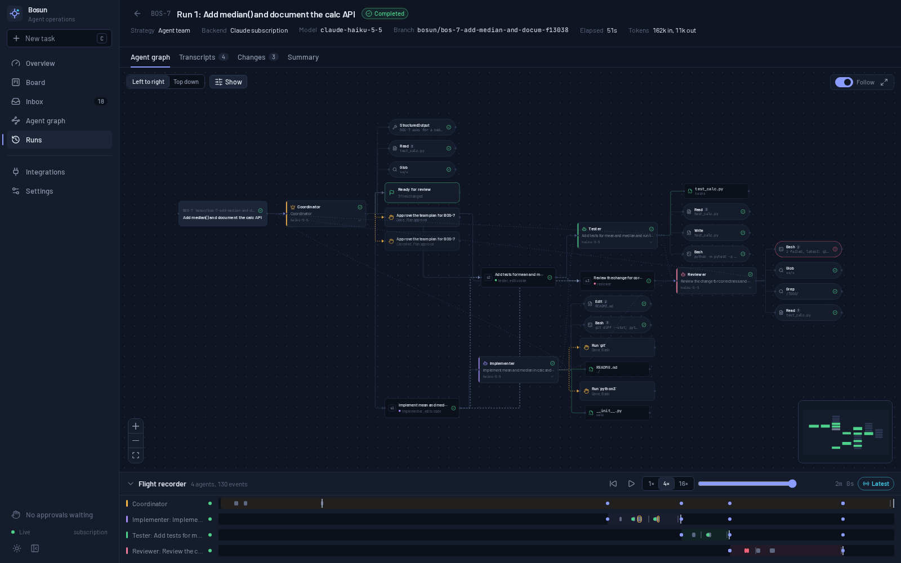

# Validation

What has been exercised against the real services, as opposed to the
automated tests. The automated tests use the deterministic demo backend and a
scripted stand-in for the Agent SDK client.

Environment: Linux (WSL2), Python 3.12, `claude-agent-sdk` 0.2.168 with its
bundled Claude Code CLI 2.1.301, a Claude Max subscription signed in via
`claude auth login`, the GitHub CLI signed in, and Chromium (headless) for UI
checks. Runs used the `haiku` model to keep usage small.

## Claude Code through the Agent SDK

| Check | Result |
|---|---|
| Provider status | `claude auth status` is parsed: logged in, `authMethod: claude.ai`, `subscriptionType: max`. Settings shows the account and plan. |
| Billing guard | Every real session reported `apiKeySource: "none"` (subscription) and first-party usage, and none was stopped by the guard. Blanking inherited `ANTHROPIC_API_KEY`/Vertex variables, and treating a missing `apiKeySource` as a violation, are covered by unit and scripted tests; the validation machine had no API key set. |
| Boundary hook | A direct SDK probe asked an agent to read `/etc/hostname`; the `PreToolUse` hook denied it. |
| Approvals | Bash commands outside the allow-list reached `can_use_tool` and appeared as approvals (3 tool approvals; plus 2 plan approvals, one of them cancelled by the restart). Approving through the UI and API let the agents continue. |
| Single run (BOS-6) | Implement `mean()` with tests in a scratch repository: 1 session, 1 approval, tests passing (4 passed), task moved to Review, diff shown. |
| Team run (BOS-7) | Plan → approval → implementer + tester in their own child worktrees → merged into the run branch → reviewer → coordinator summary. 4 sessions, all on the subscription. The backend was restarted mid-run: the run became *interrupted* and the pending plan approval was cancelled. Resume re-requested the plan approval, then continued the same sessions. |
| Single run + integrate (BOS-9) | Add `median()` with tests. The agent's own test run passed 6/6. **Merge into main** first refused without `confirm`, then merged (`--no-ff`). The merged code passes 6/6 on the user's branch. |
| Shell sandbox | With *Run shell commands in Claude Code's sandbox* on: without `socat` installed, the CLI ran the command **unsandboxed** until `failIfUnavailable` was added; it now refuses to start, and the run fails with `sandbox_unavailable`. With `bubblewrap` and `socat` available: a write inside the worktree succeeded, and a write to `$HOME` written to evade the path heuristic (`H=/ho; touch "${H}me/…"`) failed with "Read-only file system". Commands still went through the approval queue. |
| Agent environment | Agent `python3` was Bosun's own virtualenv when launched with `uv run`. Fixed: the app's venv is removed from agent `PATH`. |

## GitHub (read-only)

| Check | Result |
|---|---|
| Auth | The token was taken from the GitHub CLI at request time. Status shows the login, the token source (`gh`) and the remaining rate limit. |
| Repository listing | 23 repositories listed. |
| Sync | `ArrushC/workstation` synced: 2 open pull requests imported into the Inbox. A second sync reported `created: 0, unchanged: 2`, so nothing was duplicated. |
| PR tasks | A task created from a PR started its worktree from the PR head (fetched read-only into `refs/bosun/pr-N`, commit `98f9038`), not from the local branch. |
| Writes | None. The client only implements `GET`. |

## MCP interface

`bosun-mcp` was started over stdio by an MCP client:

- `list_tools` returned the six tools.
- `list_workspaces`, `list_tasks` and `list_pending_approvals` returned live
  data.
- `create_task` and `start_run` (demo backend) created a task and a run that
  completed.
- `get_run_status` reported the run.

## UI

The pages below were checked in headless Chromium at 1440×900 in the dark
theme, with no console errors. The dashboard was also checked in the light
theme. After the redesign (Atkinson Hyperlegible Next, roomier layout),
every page, the task sheet, both task dialogs and the collapsed sidebar
were checked again at 1440×900 in both themes against demo-backend runs,
again with no console errors. The screenshot below predates the redesign.

- Dashboard, Board, Inbox, Agent graph, Runs
- A real team run and a real single run (graph, transcripts, changes)
- Integrations and Settings
- Task sheet and launch dialog

## Workflows (milestone 1)

Checked on 2026-10-21 against a throwaway instance (its own data folder and
port) running the `workflows-m1` branch, with the demo workspace. The SDK and
CLI were the same versions as above; the account was on a Claude Pro
subscription. Browser checks used Playwright 1.64 with headless Chromium.

**Real Claude runs** (subscription, every step on `haiku`):

| Run | Result |
|---|---|
| *Map, document, review* on a new task (BOS-6) | Three steps in a row: Researcher maps two modules, Implementer adds a module docstring, Reviewer checks it. Completed in 41 s, 3 sessions of 3 turns each, all reporting `claude-haiku-5-5`, so the per-step model override was used. Each step's report built on the one before. The run branch changed exactly one line, the docstring the implementer reported. |
| *Turn limit check* on an existing task (BOS-5) | A step limited to 1 turn that needs several, a step after it, and an independent step. The first failed twice ("Reached the maximum of 1 turns"; the default of two attempts); the second was marked skipped ("Not run: it waits for Read every module, which did not finish."); the independent step completed. The run failed with "Read every module failed: Reached the maximum of 1 turns. Not run: Summarise for users." and the run page advised raising the step's turn limit. |
| Agent deleted during a run | A custom agent used by a later step was deleted while the run was going. The step still ran with the agent as it was when the run started, because runs freeze their agents. |

**Acceptance checks in the browser** (demo backend):

| Check | Result |
|---|---|
| Build a workflow | From the empty Workflows page: a new workflow, four steps added from the empty canvas, a step's **+** and the settings panel, names and instructions typed in, a parallel pair after one step, **Tidy up**. Each new step was selected with its name ready to type over. |
| Run on a new task, review, merge | Run on a new task (BOS-7, BOS-8) from the Run dialog: the task was created, the run completed, **Changes** showed the merged result of all steps, and **Merge into main** merged it. Starting on an existing task (BOS-2) worked the same way. |
| Validation as you edit | Clearing a step's name showed a problem on the step in under 0.6 s; **Run** was disabled with the reason and came back once fixed. The server refused an invalid workflow with the same message ("Translate strings: There is no agent called 'translator'…"). |
| Two tabs | A tab with no unsaved edits picked up the other tab's save. With unsaved edits in both, the second save became a conflict: the first tab's save was kept, the second kept its text, and **Load theirs** showed the other version. |
| Editing during a run | Renaming a step while its run was going changed neither the run's steps nor its page; the run kept the revision it started from. |
| Failure and skips | Shown by the real run above. |
| Existing run modes | A team run and a single-agent run on the demo backend completed and looked as before: coordinator, **Plan**, subtask keys, "Agent team" and "Single agent". |

**Keyboard only:** from the Workflows list, **New workflow**, the name, the
first step from the empty canvas, its instructions, **Run**, a title and
**Enter** started one run, all without the mouse. On the canvas, **Tab**
reaches each step and connection, **Enter** selects a step, the arrow keys
move it (the move is saved), **A** opens the add menu, **Delete** removes a
step with an **Undo** toast, **Ctrl+Z** and **Ctrl+Shift+Z** undo and redo,
and typing in a field is never taken as a shortcut. **Wait for another step**
connected two existing steps, offering only the step that neither waited for
the other already nor would have made a loop. Closing the Run dialog
returns focus to **Run**; closing a menu with **Escape** returns focus to its
button.

**Visual review:** the list (empty, loading, error and full), the editor
(empty, a selected step, workflow details, problems, warnings, the add
menu, a deleted step with **Undo**, a save conflict), the Run dialog (new and
existing task, a refusal, unsaved changes), the workflow's **Runs** tab and
the run page (live, completed, failed with skips) were checked in both themes
at 1440×900, and the main screens at 1280×800 and 1024×768, where the step
settings open over the canvas. There were no console errors other than the
409 the browser logs during the conflict check. Screenshots are in
[docs/design/workflows](design/workflows/) (`m1-*.png`).

**Accessibility:** axe-core 4.10 (WCAG 2.1 A and AA rules) on ten workflow
screens in both themes. It found light-theme status colours and muted text
below 4.5:1 and a run-header link told apart by colour alone; both are
fixed. Still open: `aria-hidden-focus` whenever a menu is open, in every
menu in the app (the Board's **Filters** menu too). See
[Open follow-ups](#open-follow-ups).

## Running as a service

Checked on WSL2 (AlmaLinux 9.8, systemd 252), replacing the Docker instance
on port 8787.

| Check | Result |
|---|---|
| Install | `scripts/start.sh` wrote and enabled the user unit, turned on lingering (`Linger=yes`) and started Bosun on `127.0.0.1:8787`, serving the built UI. Over an older unit it rewrote the unit and restarted Bosun. With an identical unit already running, it said so and changed nothing. With the service stopped, it started it. shellcheck is clean. |
| Foreground | `--foreground` with a separate data folder and port ran Bosun in the terminal and served the UI. |
| Process | The unit's main process was Bosun's own Python, so `SIGTERM` reaches it directly. Its `PATH`, from the login shell, had the mise shims and `~/.local/bin`. The data folder defaulted to `~/.local/share/bosun`, and the Docker instance's database there was picked up. |
| UI rebuild | With unchanged sources, Bosun was up in about 2 seconds. After a UI file changed, a restart ran `tsc` and `vite build` first and was up in about 9 seconds. |
| Logins | GitHub was connected through the GitHub CLI (`source: gh`). Claude used the host's Claude Code login. |
| Projects anywhere | A checkout outside the projects folder (`~/.config/mise`, `ArrushC/workstation`) was added as a workspace and scanned (10 TODOs found). Its GitHub repository synced read-only: 1 open pull request imported. |
| WSL restart | After WSL restarted (2026-10-21) the unit started on its own about two minutes after boot, rebuilt the UI from the checkout and applied a pending database migration before serving. So whatever the checkout holds is deployed at the next start, including one after a reboot; back up the data folder before updating the checkout, not just before a restart. |

## Docker image and compose setup

Checked on Docker Desktop 29.8 (WSL2) with Docker Compose 5.5, and before
that on Podman 5.8, using the same `docker compose` CLI against Podman's
Docker-compatible API. End-to-end checks used a separate throwaway stack
(`-p`, its own port, data and test repository).

| Check | Result |
|---|---|
| Image | `docker compose build` (BuildKit) succeeded in about 90 seconds. Inside: Claude Code 2.1.301, Python 3.12, uv, Node.js 24, git, running as uid 1000. |
| `scripts/docker-setup.sh` | Wrote UID/GID and the projects, data and home folders to `.env` and kept them on a re-run. It made the home folder private (`drwx------`). It refused `/`, the home directory, a missing folder and a container home inside the projects folder. shellcheck is clean. |
| Home folder | The container's home is the host's `~/.config/bosun`, with no Docker volumes left. Claude Code's `.claude.json` and `.claude/` appeared there, owned by the host user. An MCP server added with `claude mcp add --scope user` in the container was written to that `.claude.json`, and removing it removed it there. npm's cache is in its `.cache` folder. |
| Network | Published on `127.0.0.1` only. A foreign `Host` and a cross-site `Origin` were both rejected with 403. |
| Same-path mounts | A workspace in the mounted projects folder was scanned (TODO found). A demo-backend run created its worktree in the mounted data folder. The host's own `git worktree list` showed it at a valid path, and the database, worktree and git metadata were owned by the host user. **Merge into main** produced a merge commit in the host repository. |
| Agent environment | Inside the container, agent processes saw no `BOSUN_*` variables, and `python3` resolved to the system interpreter, not Bosun's virtualenv. |
| Lifecycle | `compose stop` shut down cleanly in about a second (tini forwards SIGTERM). After a restart, data was intact and the health check reported healthy. |
| Claude login | `claude auth status` reported signed out. `claude auth login` printed a sign-in URL and waited for the pasted code. A full sign-in needs a person, so it was not completed. |
| MCP | `bosun-mcp` run with `exec -i` inside the container listed its six tools and returned live data. |
| UI | The Settings page served from the container showed the container notice under the sandbox setting, with no console errors. |
| Podman | Compose's BuildKit builder crashes under rootless Podman, so there the image has to be built with `podman build`. Everything else above also passed on Podman. |

## Automated tests

- Tests (commands in the README's Development section)
  - Backend: 135 tests. They cover:
    - the scanner, GitHub client and connector (mock transport);
    - single, team and auto runs with the demo backend;
    - worktrees and integration;
    - approvals and their races;
    - pause, cancel, resume and retry races;
    - restart recovery and failure kinds;
    - the Claude adapter against a scripted SDK client (event mapping, billing
      guard, timeouts during approvals, background tasks, sandbox fail-closed);
    - the HTTP API and WebSocket;
    - redaction and the workspace boundary;
    - recovery of a subtask whose agent finished just before a restart;
    - workflows: every validation rule, the step order, parallel steps and
      joins, prompts and overrides, failure with skips and retry, pause and
      resume, refusals, editing during a run, old run configs, the migration
      from a database with data, and the API (including conflicts, the
      idempotency key and cleaning up a new task when the run can't start).
  - Frontend: 48 tests. They cover the graph reducer over recorded event logs
    (team and workflow runs), the event-log merge, UI flows (create a task,
    launch with idempotency, approvals, board moves, live updates), and
    workflows: the editing helpers, the list, problems and a disabled
    **Run**, saving against a revision and conflicts, adding and selecting
    steps, focus after adding, undo, connecting steps from the settings panel,
    and the Run dialog's request, idempotency key and refusals.
- Lint: ruff, basedpyright (standard) and `tsc` are clean.

## Not validated against real services

- Anthropic API key and Vertex AI providers. These are implemented and covered
  by unit tests for environment and billing-guard expectations, but no billed
  run was made.
- macOS (Seatbelt) sandboxing.
- A real Claude run inside the Docker container (it needs the container's own
  Claude sign-in).
- A real Claude run under the systemd service. Earlier real runs used
  `uv run bosun` directly, and the workflow runs used a separate instance.
- The service staying up after the last WSL terminal closes. Lingering is on,
  but this wasn't checked.
- Very long runs (hours), and runs near the subscription usage limit. The
  `usage_limit` path is tested with scripted CLI output only.

## Open follow-ups

### Open menus leave focusable controls inside hidden content

While any dropdown menu is open, axe-core reports `aria-hidden-focus`
(impact "serious"; WCAG 2.0 level A, 4.1.2 Name, Role, Value). It was found
in the workflows milestone 1 review and reproduced on the running service on
2026-10-21. It is not fixed. It affects every menu in the app, not only
workflows, but that doesn't make it acceptable.

To reproduce:

1. Open **Board** and run axe with the `wcag2a`, `wcag2aa`, `wcag21a` and
   `wcag21aa` tags (axe-core 4.10, or the axe DevTools extension). There are
   no violations.
2. Tab to **Filters** and press `Enter`.
3. Run axe again.

Result: one `aria-hidden-focus` violation. Radix's modal menu calls
`hideOthers` from the `aria-hidden` package, which sets `aria-hidden="true"`
on the app shell's container (`div.flex.h-full.min-h-0` in `AppShell.tsx`).
That container still holds focusable controls: the rail links and the page's
buttons and fields. The workflow editor's **Add a step** menu gives the same
result.

Expected: no violations while a menu is open.

What already works: focus moves into the menu, `Tab` doesn't leave it, and
`Escape` closes it and returns focus to **Filters**. The failure is that
controls hidden from assistive technology can still take focus.

Versions: `radix-ui` 1.8.1 (`@radix-ui/react-dropdown-menu` 2.2.1),
`aria-hidden` 1.2.6, axe-core 4.10.3, headless Chromium.

Options to try (none tested yet):

- Make the hidden content inert as well; the `aria-hidden` package also
  exports `inertOthers`.
- Make the menus non-modal (`modal={false}`) and check that focus still
  behaves.
- Use a newer Radix release, if one changes this.

Then rerun axe with a menu open in both themes, along with the keyboard
walk-through in [Workflows](#workflows-milestone-1).
